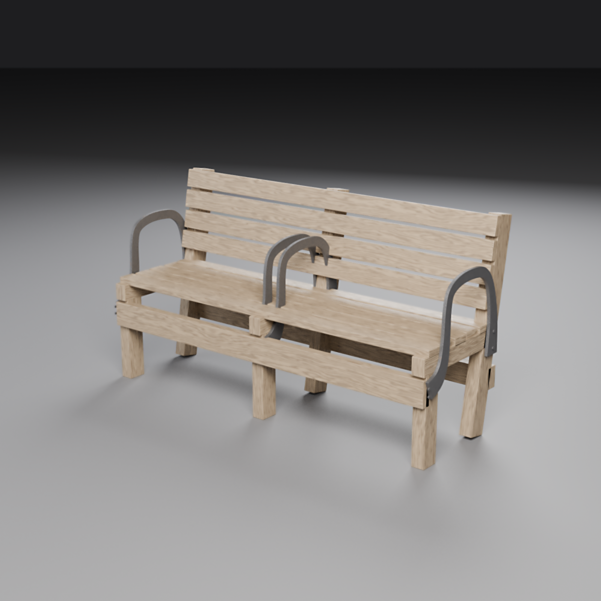
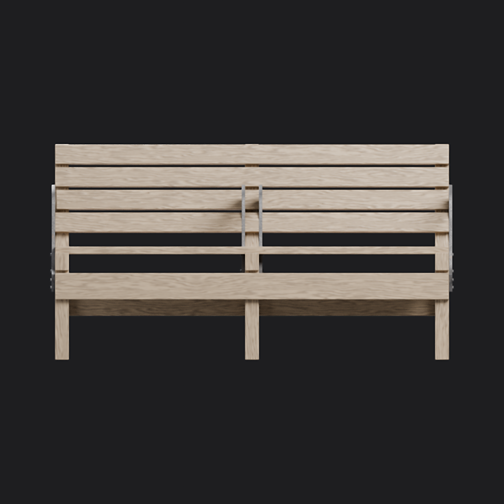
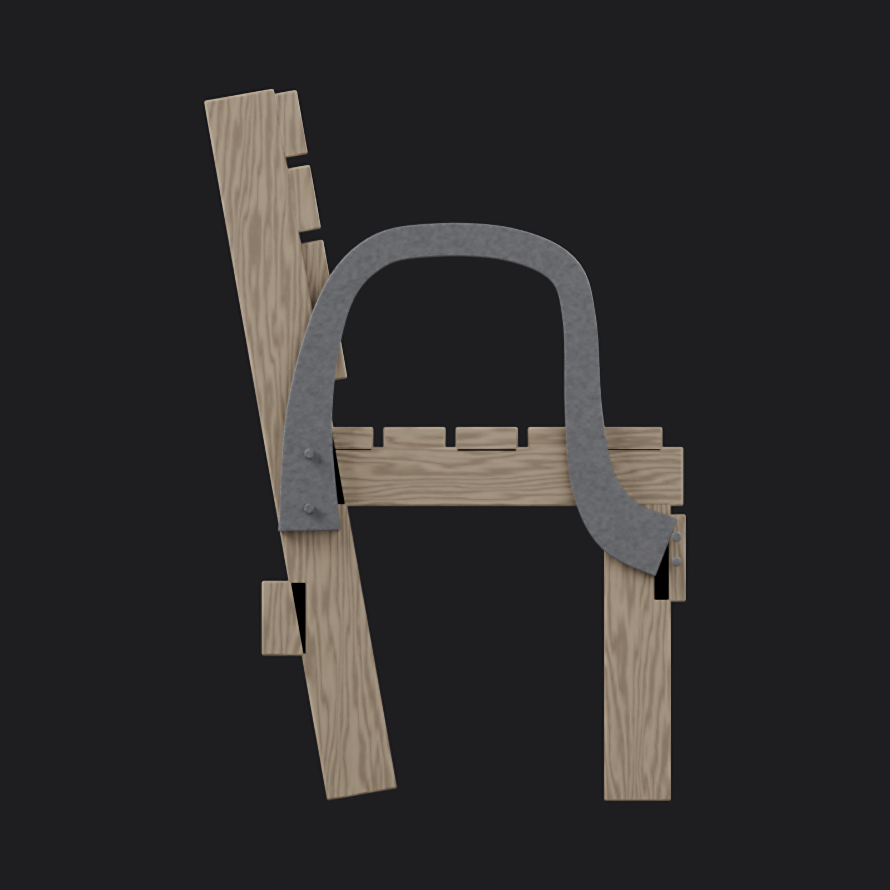
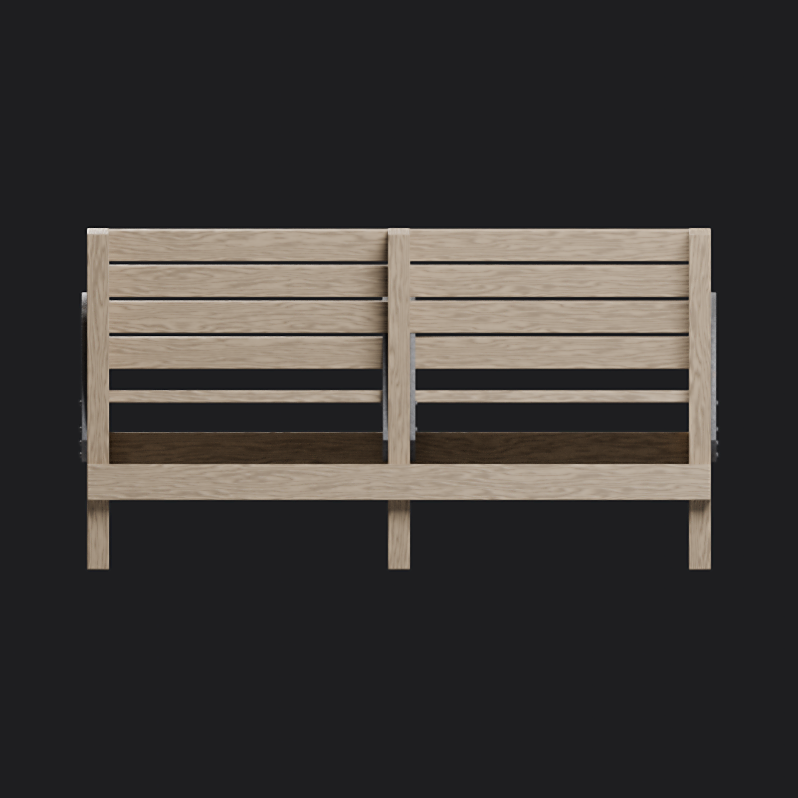
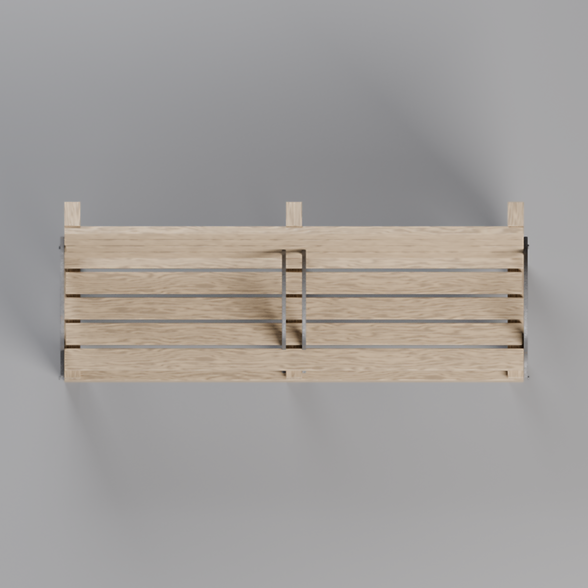

# Wooden bench with iron armrests

A full-size slatted park bench with timber trestles and four dark iron arched armrests. This generic piece is an interpretation of the requested subject, not a replica of a branded product or a scan.

## What this model depicts

Five long boards form the seat, with four boards forming the back. Three trestles support the seating, and a front apron and rear brace join the legs. Four curved arm assemblies divide the seating: one on either end and a pair around the centre support. Raised hexagonal bolt heads suggest how the iron attaches to the timber.

The wood uses an authored oak-like grain, with a varied finish and relief. Dark, mottled metallic iron contrasts with the warm timber. The model is intended as a believable outdoor furnishing rather than a forensic reconstruction; its intersecting components are distinct mesh shells rather than machined joinery.

## Dimensions and scale

The bounding box is approximately **1.602 m wide × 0.579 m deep × 0.857 m high**. Seat height is 0.45 m and the arm top is approximately 0.68 m. In Blender, X runs along the bench, front faces −Y, and Z is up. The parent origin is at ground centre; the lowest point is Z = 0. The glTF export uses Y up and metres.

## Technical sheet

| Property | Value |
| --- | --- |
| Category | Hard-surface prop |
| Triangles | 12,512 |
| Mesh objects | 11, parented to wooden_bench empty |
| Materials | 2 PBR metallic-roughness |
| Textures | Wood 2048² and iron 1024², base colour, roughness and normal |
| UV layout | One set, intentionally tiled and reused across components |
| Formats | Self-contained GLB; packed editable Blender source |
| Re-import | 11 meshes, 12,512 triangles, Blender bounds −0.801 to 0.801 X, −0.3030 to 0.2764 Y, 0 to 0.857 Z |
| Animation / LOD | None |

## Materials

`wood_oak_bench` uses image-based grain, roughness and tangent-space normal with metallic 0. `metal_cast_iron_weathered` uses a mottled iron base colour, roughness and normal with metallic 1. The PNG textures were generated specifically for this asset and are embedded in the GLB and packed into the Blender file. Image maps are also supplied separately for editing.

## Render set

The square studio set shows hero, front, side, back, top, detail, wireframe and a scale-reference view. The detail is an inspection crop of the side render, enlarged from 1000 × 1000 pixels, rather than an independently rendered close-up. The rig uses low-memory post-denoising, followed by mild sharpening; all output images are 1600 × 1600 pixels and were rendered with Cycles.

## Usage notes

Open the packed `.blend` directly in Blender, or import the GLB into a glTF 2.0 compatible application. Use metre scale and place the parent at ground level. The render rig can recreate the views from the package directory with `blender -b model/wooden-bench.blend --python ../../tools/render_rig.py -- --res 1600 --samples 96 --out renders`.

## Limitations

- Timber and iron parts intersect as closed component shells; the assembly is not a single watertight printable solid and joinery is simplified.
- Reused, tiled UVs can reveal repetition at close range; normal-map response and shading may vary between glTF viewers.
- There are no collision meshes, animation, separate LODs, or engineering tolerances.
- The arm straps and bolts are visual approximations rather than load-tested or manufacturing-ready hardware; some fastener heads appear offset from the strap, and small gaps remain at the rear brace.
- The rig’s low-memory post-denoising softens fine detail; the armrest close-up is enlarged from a crop, not a native-resolution detail render.

## Self-review

Real-world scale and the ground origin were checked against the exported bounds. Hard edges have applied bevels. The GLB was re-imported and inspected for mesh count, bounds and triangle count; its textures are embedded. The render set includes the orthographic views and a scale reference. The result is a generic representation and does not claim scan-level realism.

## Licence & credits

Geometry and texture maps were authored for this repository using Blender, NumPy and Pillow. No third-party meshes or image textures were used. Released under **CC BY 4.0**; see the repository licence.
